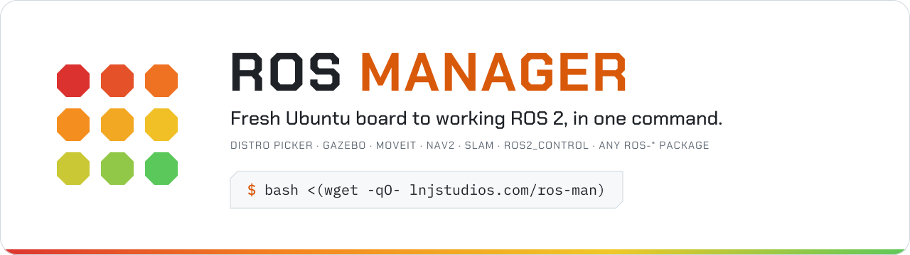

<p align="center">
  <picture>
    <source media="(prefers-color-scheme: dark)" srcset="assets/banner-dark.svg">
    
  </picture>
</p>

<p align="center">
  
  
  <a href="LICENSE"></a>
</p>

**From a fresh Ubuntu board to a working ROS 2 in one command.** ROS Manager picks the right distro for your Ubuntu, sets up the official apt source, installs ROS 2 plus the packages you actually use (Gazebo, MoveIt, Nav2, SLAM, ros2_control…), initialises rosdep, checks that it all works and wires it into your shell.

It's a single bash file and only needs what Ubuntu already ships with, so it runs on a Raspberry Pi, a cloud VM, a Jetson or a desktop.

## Quick start

```bash
bash <(wget -qO- lnjstudios.com/ros-man)
```

With curl: `bash <(curl -fsSL lnjstudios.com/ros-man)`. The short link redirects to [`ros-manager.bash`](ros-manager.bash) in this repo; the direct URL is `https://raw.githubusercontent.com/koustavbetal/ros_manager/v2/ros-manager.bash`.

The interactive flow asks a few questions in place (no full-screen dialogs) and shows exactly what it will do before it touches anything.

### New board, no questions

You know what you want, so skip the prompts:

```bash
# a headless robot: ROS 2 base + Nav2 + SLAM + dev tools
bash <(wget -qO- lnjstudios.com/ros-man) -t base -w nav2,slam -d -y

# a workstation: Jazzy desktop, simulation, arm planning
bash <(wget -qO- lnjstudios.com/ros-man) -v jazzy -t desktop -w gazebo,moveit,urdf -d -y
```

Leave out `-v` and it picks the recommended distro for that Ubuntu. Leave out `-t` and it chooses `desktop` when a desktop is installed, `base` otherwise.

### Look before you run

```bash
wget -O ros-manager.bash lnjstudios.com/ros-man
less ros-manager.bash
bash ros-manager.bash -n      # dry run: the whole flow, nothing changes
bash ros-manager.bash
```

## What it does

1. **Shows what's there:** OS, CPU, memory, disk, locale, your shell, any ROS 2 already installed, and the distros built for this Ubuntu. The distro list comes live from [rosdistro](https://github.com/ros/rosdistro), so new releases show up without updating the script.
2. **Asks, or follows your flags:** distro, desktop or headless, plugins, and any extra `ros-<distro>-*` package from a live search of the ROS repository.
3. **Installs:** locale (UTF-8), the official `ros2-apt-source`, a system upgrade on fresh installs, ROS 2, your plugins and packages, then `rosdep init` and `rosdep update`. Progress is shown as two bars; press `l` for the live apt log.
4. **Checks it works:** a clean shell sources `/opt/ros/<distro>/setup.bash` (or `.zsh`) and runs `ros2`. If that fails, it offers to run the install steps again.
5. **Wires up your shell:** last of all, it asks before adding the `source` line to `~/.bashrc` or `~/.zshrc`. If your rc file already sources that distro, it leaves the file alone.

### Already have ROS 2?

It won't blindly reinstall. You get a menu instead:

| Choice | What happens |
|---|---|
| **plugins** | add packages to the distro you have; anything already installed is shown and locked |
| **replace** | remove the current distro, then install another |
| **parallel** | install a second distro next to it (works, but don't source both in one shell) |
| **remove** | uninstall every `ros-<distro>-*` package and the line in your rc file |

## Options

| Flag | |
|---|---|
| `-v, --version DISTRO` | `humble`, `jazzy`, `kilted`, `lyrical`, `rolling`… (default: recommended for this Ubuntu) |
| `-t, --type TYPE` | `desktop` or `base` |
| `-w, --with LIST` | plugins, comma separated: `gazebo,moveit,nav2,slam,urdf,control,teleop,devtools` |
| `-d, --dev` | same as `--with devtools` (colcon, rosdep, vcstool) |
| `-p, --packages LIST` | any package from the ROS repo: `nav2_bt_navigator`, `nav2-bt-navigator` or `ros-jazzy-nav2-bt-navigator` |
| `--no-upgrade` | skip `apt-get upgrade` |
| `--no-rc` | don't touch `~/.bashrc` / `~/.zshrc` |
| `--remove DISTRO` | uninstall a distro |
| `-y, --yes` | no questions; defaults for anything not given |
| `-n, --dry-run` | run the whole flow without changing anything |
| `-h, --help` | help |

v1's `-f desktop|server` still works.

## Supported systems

| Ubuntu | ROS 2 |
|---|---|
| 22.04 LTS (Jammy Jellyfish) | Humble Hawksbill |
| 24.04 LTS (Noble Numbat) | Jazzy Jalisco, Kilted Kaiju |
| 26.04 LTS (Resolute Raccoon) | Lyrical Luth, Rolling Ridley |

This table is a snapshot. The script asks rosdistro at run time, and the picker shows every ROS 2 distro: green if built for your Ubuntu, yellow if active elsewhere, red if end of life. Shells: bash and zsh (ROS 2 has no setup file for fish).

Logs are written to `~/.local/state/ros-manager/`.

## Roadmap

1. **Installer** (this release)
2. Workspace templates: `robot_description`, `robot_control`, `robot_nav`…
3. URDF authoring
4. Joint testing and hardware bring-up with ros2_control

The installer stays a single bash file that runs headless, on a Pi or in CI.

## Contributing

Issues and ideas are welcome. To test changes without touching your machine, use the Docker sandbox in [`sandbox/`](sandbox/README.md).

Looking for v1 (`rosinstaller.bash`)? It lives on the [`v1`](https://github.com/koustavbetal/ros_manager/tree/v1) branch.

---

<p align="center">
  <a href="https://lnjstudios.com">
    <picture>
      <source media="(prefers-color-scheme: light)" srcset="assets/lnj-studios-dark.svg">
      
    </picture>
  </a>
</p>

<p align="center"><sub>
  Made by <a href="https://github.com/koustavbetal">Koustav Betal</a> at <a href="https://lnjstudios.com">LNJ Studios</a> · MIT © 2025–2026 Koustav Betal<br>
  ROS is a trademark of Open Robotics. ROS Manager is an independent project and is not affiliated with or endorsed by Open Robotics.
</sub></p>
